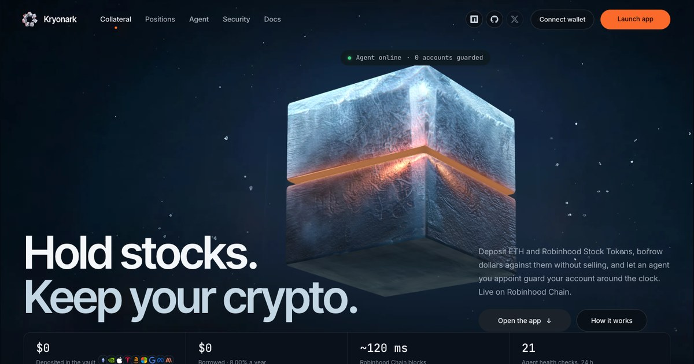

# Kryonark

**Hold stocks. Keep your crypto.** Kryonark is a lending vault on Robinhood Chain: deposit ETH and Robinhood Stock Tokens as collateral, borrow dollars (USDG) against them without selling, and appoint a guardian agent that can top up your collateral from your own buffer and can never withdraw.

[kryonark.xyz](https://kryonark.xyz) · [docs](https://kryonark.xyz/docs) · [security](https://kryonark.xyz/security) · [npm](https://www.npmjs.com/package/kryonark) · `npx kryonark`



## Live contracts

| | Robinhood Chain mainnet (4663) |
|---|---|
| KryonarkVault | [`0x857C224f9896c9A0F17f564D9C8Ba9Cf73802764`](https://robinhoodchain.blockscout.com/address/0x857C224f9896c9A0F17f564D9C8Ba9Cf73802764) |
| KryoOracle | [`0xBbeAd3C159b4f722a059bB508F51a01944Db41c8`](https://robinhoodchain.blockscout.com/address/0xBbeAd3C159b4f722a059bB508F51a01944Db41c8) |
| Debt asset | USDG `0x5fc5360D0400a0Fd4f2af552ADD042D716F1d168` |
| Collateral | ETH (80%), NVDA, AAPL, TSLA, AMZN, MSFT, GOOGL, META, ANT (70%) |
| Prices | Chainlink for ETH and seven stocks; ANT and USDG pushed by the agent (each update capped at 25%) |
| Source | Verified on [Sourcify](https://repo.sourcify.dev/4663/0x857C224f9896c9A0F17f564D9C8Ba9Cf73802764) (exact match) |

The same code was run end to end on Robinhood Chain testnet (46630) before mainnet: deposit, borrow, a real agent top-up (health 1.28 → 1.50), repay and withdraw. All addresses also live at [`/assets/network.json`](https://kryonark.xyz/assets/network.json).

## How it works

- **Health** = Σ(collateral value × weight) ÷ debt. ETH counts 80%, Stock Tokens 70%. Borrowing or withdrawing must leave health at **1.25** or more; below **1.00** anyone can liquidate up to half the debt at a 5% bonus.
- **The guardian agent** (an address you appoint with `setGuardian`, up to 90 days, revocable) can call exactly one function, `guardTopUp`, which moves your ETH buffer into your collateral while your health is below **1.30**. The Kryonark agent checks every account every few seconds and tops up to about 1.50.
- **Lenders** supply USDG and own shares of the pool's cash plus outstanding debt; borrowers pay a simple yearly rate (8%) into it.
- **Pause** stops new deposits and borrowing only. Repaying and withdrawing always work.
- **Intents**: the site turns sentences (English or Indonesian) like `Borrow $50` or `Protect my account with 0.05 ETH` into the matching call for your wallet to sign.

## What is in this repo

| Folder | What it is |
|---|---|
| [`contracts/`](contracts) | `KryonarkVault`, `KryoOracle` (Chainlink feeds with a bounded pushed fallback) and `TestUSD` (testnet only). Foundry, 13 tests. |
| [`agent/`](agent) | The guardian agent: pushes prices for assets without a Chainlink feed, watches every account, tops up guarded ones, serves `/agent/api/status`. Its key is created on the server and never leaves it. |
| [`web/`](web) | kryonark.xyz. Static HTML/CSS/JS: the 3D ice vault, wallet connect (EIP-6963), the live vault, the intent box, docs and security pages. |
| [`studio/`](studio) | Owner panel at /studio: deploy the contracts from the owner's browser wallet, token CA, buyback and burn. |
| [`packages/kryonark/`](packages/kryonark) | `npx kryonark`: read the live vault, any account's health, the agent's heartbeat. No dependencies. |
| [`deploy/`](deploy) | nginx config and the deploy script. |

```bash
npx kryonark                    # protocol totals, prices, the agent
npx kryonark account 0xYourAddr # collateral, debt, health
```

## Develop

```bash
cd contracts && forge test                       # 13 tests
cd packages/kryonark && npm test
cd web && python3 -m http.server 5820            # the site, reads assets/network.json
```

## Risks

Not audited yet; the owner key is a single wallet today and should move to a multisig with a timelock before the caps go up. Robinhood can pause, block or burn Stock Tokens. Stock Tokens may not be offered to US persons, so Kryonark isn't for US persons. Details: [kryonark.xyz/security](https://kryonark.xyz/security).

## Credits

three.js r160 (MIT) · ethers 6.13.4 (MIT) · forge-std (MIT/Apache-2.0) · network and token logos from [web3icons](https://github.com/0xa3k5/web3icons) (MIT) · stock logos from [Simple Icons](https://simpleicons.org) (CC0). Brand logos stay the property of their owners and are used only to name the assets involved.

MIT
